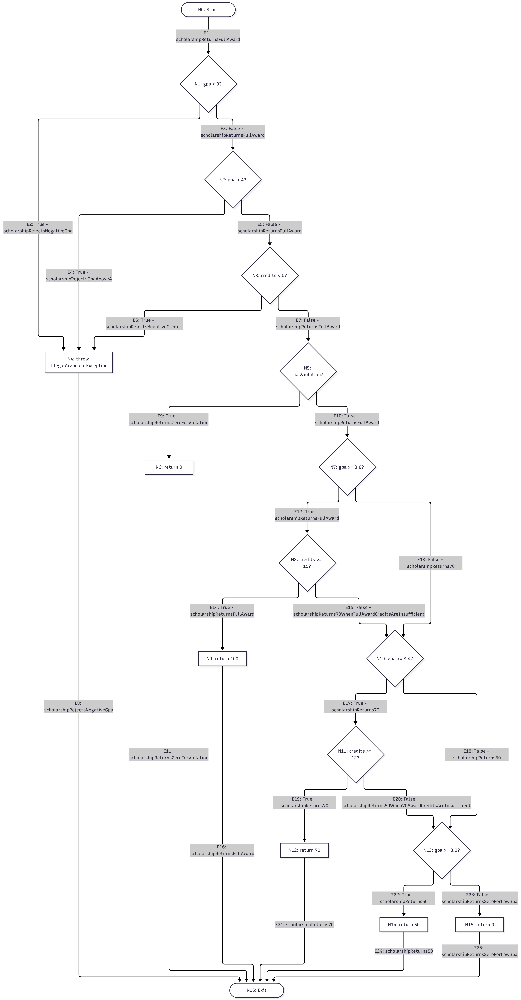

# Лаборатори №9 — JaCoCo код хамралт

**Хичээл:** F.CSA313 — Программ хангамжийн чанарын баталгаа ба тест  
**Гүйцэтгэсэн:** Х.Цогтбаяр  
**Оюутны код:** B232270072

## Ашигласан орчин

### java -version

```text
openjdk version "21.0.13" 2026-10-20
OpenJDK Runtime Environment (build 21.0.13+9-1-deb13u2-Debian)
OpenJDK 64-Bit Server VM (build 21.0.13+9-1-deb13u2-Debian, mixed mode, sharing)
```

### mvn -version

```text
Apache Maven 3.9.9
Maven home: /usr/share/maven
Java version: 21.0.13, vendor: Debian, runtime: /usr/lib/jvm/java-21-openjdk-amd64
Default locale: en_US, platform encoding: UTF-8
OS name: "linux", version: "6.12.113+deb13-amd64", arch: "amd64", family: "unix"
```

## Зорилго

`ScholarshipCalculator` классын `letterGrade()`, `gpa()`, `scholarship()` функцүүдийг JUnit 5 ашиглан тестэлж, JaCoCo-оор Line болон Branch хамралтыг хэмжив. Хамралтыг 100% болгосны дараа зааг утгын тестээр алдаа илрүүлж, засварын үр дүнг дахин шалгав.

## A. Хэвийн урсгалын тестүүд

`ScholarshipCalculatorTest` класст эхний 5 тестийг бичсэн.

| Тест | Оролт | Хүлээгдэх үр дүн |
|---|---|---|
| `letterGradeReturnsA` | 95 | A |
| `letterGradeReturnsB` | 85 | B |
| `letterGradeReturnsC` | 75 | C |
| `gpaReturnsAverage` | [95, 85] | 3.5 |
| `scholarshipReturnsFullAward` | 3.9, 16, false | 100 |

Бүх 5 тест амжилттай болсон.

| Үзүүлэлт | Хамрагдсан | Дутуу | Тооцоо | Хамралт |
|---|---:|---:|---|---:|
| Line | 15 | 10 | 15 / (15 + 10) × 100 | 60% |
| Branch | 20 | 21 | 20 / (20 + 21) × 100 | 48.78% |

Буруу оролтын exception замууд болон D/F дүн буцаах мөрүүд шалгагдаагүй тул тайланд улаанаар харагдсан. Тэтгэлгийн 100%-ийн хэвийн зам ажилласан боловч бусад хувь болон татгалзах замууд шалгагдаагүй үлдсэн. Шар ромбо нь тухайн нөхцөлийн зарим салаа ажилласан боловч бүх салаа хамрагдаагүйг харуулсан.

Нотолгоо:

- [Maven гаралт](results/mvn-verify-A.txt)
- [JaCoCo CSV](results/jacoco-A.csv)

## B. CFG болон бүрэн хамралт

`ScholarshipCalculatorCoverageTest` класст нэмэлт 16 тест бичиж, нийт **21 тестээр** шалгасан. Буруу оролтуудад `assertThrows` ашиглан `IllegalArgumentException` шидэж байгааг баталгаажуулсан.

Нэмж шалгасан замууд:

- `letterGrade()`: D, F болон онооны хязгаараас гадуурх оролтууд.
- `gpa()`: null, хоосон массив, switch-ийн A/B/C/D болон default замууд.
- `scholarship()`: сахилгын зөрчил болон 0/50/70/100 хувийн үр дүн.
- Оролтын шалгалтын `||` нөхцөл бүрийн үнэн утга: сөрөг голч, 4-өөс их голч, сөрөг кредит.
- Голч хүрсэн боловч кредит дутуу байх `&&` нөхцөлүүдийн худал утга.

| Үзүүлэлт | Хамрагдсан | Дутуу | Хамралт |
|---|---:|---:|---:|
| Line | 25 | 0 | 100% |
| Branch | 41 | 0 | 100% |

`results/jacoco-B.csv` файлд **LINE_MISSED = 0**, **BRANCH_MISSED = 0** болсон.

### scholarship() функцийн CFG



Нотолгоо:

- [Maven гаралт](results/mvn-verify-B.txt)
- [JaCoCo CSV](results/jacoco-B.csv)
- [CFG зураг](cfg.png)

## C. Давталтын заагийн тестүүд

B хэсэгт бичсэн null болон хоосон массивын тестүүдийг дахин ашиглаж, `ScholarshipCalculatorLoopTest` класст хоёр тест нэмсэн. Энэ шатанд нийт **23 тест** амжилттай болсон.

| Тохиолдол | Оролт | Хүлээгдэх үр дүн | Тест |
|---|---|---|---|
| 0 элемент | [] | IllegalArgumentException | `gpaRejectsEmptyArray` |
| Null оролт | null | IllegalArgumentException | `gpaRejectsNull` |
| 1 давталт | [95] | 4.0 | `gpaHandlesSingleScore` |
| 2+ давталт | [95, 85, 75, 65] | 2.5 | `gpaHandlesMultipleScores` |

Хоосон массив болон null оролтыг `assertThrows`-оор шалгасан. Хоосон массивын үед хамгаалах нөхцөл exception шиддэг тул давталтын биед орохгүй.

Branch хамралт 100% байсан ч давталт нэг болон олон удаа ажиллах үед тооцоолол зөв гэдгийг дангаараа батлахгүй. Эдгээр тест нь хоосон оролтын хамгаалалт, нэг элементийн тооцоо, олон элементийн нийлбэр болон дундаж зөв эсэхийг шалгасан.

## D. Зааг утгын алдаа илрүүлж зассан нь

`ScholarshipCalculatorBoundaryTest` класст долоон заагийн тест нэмсэн.

| Оноо | Хүлээгдэх дүн |
|---:|---|
| 60 | D |
| 59.99 | F |
| 69.99 | D |
| 0 | F |
| 100 | A |
| 89.99 | B |
| 90 | A |

### Засварын өмнөх үр дүн

Унасан тест: **letterGradeAt60ReturnsD**

`results/mvn-test-D-fail.txt` файлд дараах алдаа бүртгэгдсэн:

```text
[ERROR]   ScholarshipCalculatorBoundaryTest.letterGradeAt60ReturnsD:14 expected: <D> but was: <F>
[ERROR] Tests run: 30, Failures: 1, Errors: 0, Skipped: 0
[INFO] BUILD FAILURE
```

### Алдааны шалтгаан ба засвар

Спецификацийн дагуу 60 оноо D байх ёстой боловч хуучин нөхцөл 60-ыг оруулахгүй байсан.

Засварын өмнө:

```java
if (score > 60) return "D";
```

Засварын дараа:

```java
if (score >= 60) return "D";
```

Унасан тест болон нотолгоог [`b64c7a4`](https://github.com/tsogto1/f.csa313-lab9/commit/b64c7a4) commit-д, засварыг тусдаа [`a464f33`](https://github.com/tsogto1/f.csa313-lab9/commit/a464f33) commit-д хадгалсан.

### Засварын дараах үр дүн

```text
Tests run: 30, Failures: 0, Errors: 0, Skipped: 0
BUILD SUCCESS
```

| Үзүүлэлт | Хамрагдсан | Дутуу | Хамралт |
|---|---:|---:|---:|
| Instructions | 152 | 0 | 100% |
| Line | 25 | 0 | 100% |
| Branch | 41 | 0 | 100% |

Нотолгоо:

- [Унасан тестийн гаралт](results/mvn-test-D-fail.txt)
- [Эцсийн Maven гаралт](results/mvn-verify-final.txt)
- [Эцсийн JaCoCo CSV](results/jacoco-final.csv)

### Гол дүгнэлт

Branch хамралт 100% болсон нь бүх хэмжигдсэн салааг тестүүд ажиллуулсныг харуулдаг. Гэвч `score > 60` болон `score >= 60` нөхцөлүүд ижил тооны салаатай учраас хамралтын хувь дангаараа операторын зөв эсэхийг ялгахгүй. Өмнөх тестүүд 60-аас их болон бага утгаар хоёр салааг ажиллуулсан боловч яг 60 гэсэн заагийг шалгаагүй байсан. `letterGradeAt60ReturnsD` тестийг нэмэхэд спецификацийн D гэсэн үр дүнгийн оронд F буцааж байгааг илрүүлсэн. Заагийг багтаах оператороор зассаны дараа бүх тест амжилттай болж, Line болон Branch хамралт 100% хэвээр үлдсэн. Иймээс хамралтын хэмжилтийг спецификацид тулгуурласан хүлээгдэх үр дүн, зааг утгын болон давталтын тестүүдтэй хамт ашиглах хэрэгтэй.

## Ажиллуулах

Төслийн үндсэн хавтаснаас:

```bash
mvn clean verify
```

JaCoCo HTML тайлан `target/site/jacoco/index.html` замд үүснэ. `target/` хавтас нь `.gitignore`-д орсон бөгөөд build хийхэд дахин үүснэ.

## AI туслахын хэрэглээ

 тайлангийн тестийн тоо болон хамралтын хэмжилтийг `results/` дотор хадгалсан бодит гаралттай тулгасан.
